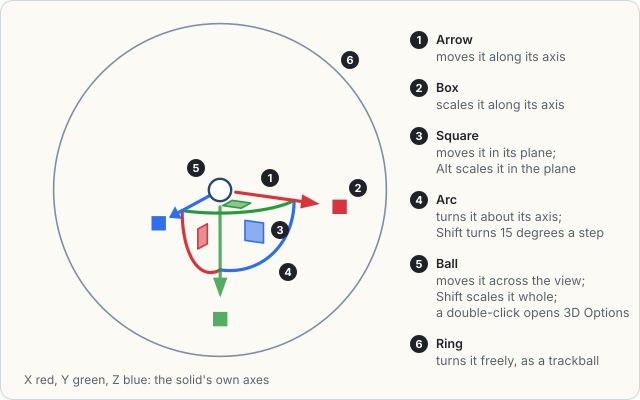

# Effects and the Appearance panel

*New in 1.0.0-alpha.5.0.0.*

## At a glance

- **The Effect menu**, between Transform and Sketch as in Illustrator, adds an
  effect to the selection: a blur, a color adjustment, a feather, a shadow, a
  glow, a bevel, an emboss, a Splatter, which draws a fill as a loose hatch,
  a Warp, which bends the selection by a style, or 3D, which builds a mark
  in depth. Each opens its options with a live preview; **OK** keeps the effect as one undo step and
  **Cancel** leaves the drawing as it was. 3D is built at once instead, and
  set live in the 3D Options panel.
- **The gumball** stands on a selected 3D mark: arrows, squares, arcs and
  boxes on the canvas that move it, turn it and scale it in depth (see
  [The gumball](#the-gumball)).
- **The Appearance panel** (`Shift+F6`, View > Toggle Appearance Panel) lists
  the selection's look in the order it is drawn: its Stroke and the effects on
  the stroke, its Fill and the effects on the fill, the effects on the whole of
  it, and its Opacity and blend. Effects are switched off and on, reordered,
  moved between the stroke, the fill and the whole, and opened again for their
  options there.
- **Effects follow a transform.** Scaling scales their lengths, turning turns a
  shadow's offset and a bevel's light, and mirroring mirrors them, while the
  setting **Scale Strokes and Effects** is on, which it is to begin with.
- **Use Preview Bounds**, off to begin with, makes a selected mark's box and
  the area a click picks it by reach as far as its effects paint.

## The Effect menu

| Row | What it adds | Where Illustrator or Photoshop has it |
| --- | --- | --- |
| Blur > Gaussian Blur | A blur of the whole mark | Effect > Blur > Gaussian Blur |
| Adjust Colors > Brightness, Contrast, Saturate, Grayscale, Sepia, Invert, Hue Rotate, Opacity | A change to the mark's colors, as the CSS filter of the same name makes it | Edit Colors, and Photoshop's adjustments |
| Stylize > Feather | Fades the edge, from clear at the edge to solid its radius inside | Effect > Stylize > Feather |
| Stylize > Outer Shadow | A shadow behind the mark, offset, blurred and spread | Effect > Stylize > Drop Shadow |
| Stylize > Inner Shadow | A shadow cast inside the mark's edge | Photoshop's Inner Shadow |
| Stylize > Outer Glow | A glow around the mark | Effect > Stylize > Outer Glow |
| Stylize > Inner Glow | A glow inside the edge, or from the center | Effect > Stylize > Inner Glow |
| Stylize > Bevel | A raised or sunken edge, inside the mark (Inner Bevel) or outside it (Outer Bevel) | Photoshop's Bevel and Emboss |
| Stylize > Emboss | The mark raised from the page (Emboss) or pressed into it (Pillow Emboss) | Photoshop's Bevel and Emboss |
| Stylize > Splatter | The fill drawn as a loose hatch, as a pen scribbles a shape in (see [Splatter](#splatter)) | Effect > Stylize > Scribble |
| Warp > Arc, Arch, Unroll, Shell, Windy, Breezy, Curvy, Chart, Puffy, Expand, Cram, Twirl | The selection bent by a style, live (see [Warp](#warp)) | Effect > Warp |
| 3D > Extrude, Revolve | The mark built in depth and drawn as shaded faces (see [3D](#3d)) | Effect > 3D (Classic) > Extrude & Bevel, Revolve |
| 3D > 3D Options | The panel that sets the selection's 3D live (see [3D Options](#3d-options)) | Window > 3D and Materials |

The rows above the effects and below them:

- **Apply Last Effect** (`Ctrl+Shift+E`) adds the effect kept last again, as it
  was set, to whatever is selected now.
- **Last Effect** (`Ctrl+Alt+Shift+E`) opens the options of the effect kept
  last, on a new one for the selection. A 3D is built at once, and 3D Options
  opens on it. Either way a 3D takes the place of a mark's own, since only one
  builds a mark.
- **Expand Appearance** bakes the effects that change what a mark draws -
  Warp, Splatter and 3D - into its anchors, or into marks of their own, and
  takes them off its list, as one undo step: a warped mark keeps its place
  with the bend in its own anchors, a splattered mark becomes a group of its
  outline and its hatch, a mark for each run of it, and a 3D mark a group of
  its faces, each a filled shape. On a lit group row, the
  group's Warp is baked into the marks it holds. The other effects only
  change the pixels and have no vector form, so they stay live. The row is
  greyed while nothing selected has a Warp, a Splatter or 3D.
- **Clear Appearance** takes every effect off the selection, as one undo step.
  The fill and the stroke stay.

The submenus open with nothing selected, to show what is in them; their rows
are greyed until something is.

Apply Last Effect, Last Effect, Expand Appearance and Clear Appearance are at
the end of the canvas's right-click menu too.

## What an effect goes on

An effect goes on the selected marks, or on the groups lit in the Layers panel
when a group row is lit. A group's effects work on its whole picture, the
marks inside drawn together first, so a shadow under a group is one shadow, not
one per mark.

A group takes a **Warp** as one: its marks bend together over the box of
everything it holds (see [Warp](#warp)). A Splatter and 3D draw on a mark's
own shape, which a group has none of, so a group takes neither.

A mark's effect can be aimed at its **stroke**, its **fill**, or the whole
mark. An effect on the fill works on the fill alone, under the stroke, so a
fill can glow while its outline stays crisp; an effect on the whole works on
the two together. Text has a fill, its ink, and no stroke; a picture has
neither, so its effects are always on the whole of it.

## The Appearance panel

The panel opens docked beside the canvas, as the Layers panel is, and can be
undocked to float over the drawing like any palette. Its rows, top to bottom:

1. What is selected: Path, Text, Image, Group, Mixed Objects, or how many.
2. **Stroke**, with its color and width, and under it the effects on the stroke.
3. **Fill**, with its color, and under it the effects on the fill. A swatch
   with a red slash is no fill, and a striped one stands for marks that differ.
4. The effects on the whole of the selection.
5. **Opacity** and the blend: the opacity and the blend of the selection's
   layers, as the Layers panel sets them.

Each effect's row has:

- an **eye** that switches the effect off without taking it away, and on again;
- its **name**, with where Illustrator or Photoshop has it in the tooltip;
- an **fx** button that opens its options, as a double-click on the row does.

**Selecting a row aims the next effect.** With the Fill row selected, an
effect added from the Effect menu or the panel's **fx** goes on the fill; with
an effect's row selected it goes where that one is. A click on the panel's
empty space aims it at the whole again.

**Reordering.** Drag a row: over the top half of another row it lands before
that one, over the bottom half after it, and over the Stroke or Fill row it
moves to the end of that row's effects. Effects work in the order they are
listed, top first, so the order changes the look: a blur above a shadow blurs
the mark before the shadow is cast from it.

**A right-click** on an effect's row offers Duplicate, Delete, Move to Fill,
Move to Stroke and Move to Object.

The panel's foot holds **fx** (Add New Effect: the Effect menu's rows as a
drop-down), **Clear** (Clear Appearance), **Duplicate** and **Delete**, the
last two for the selected effect's row.

When several marks are selected and their effects differ, the panel says
**Mixed Appearances**: a new effect is added to each of them, and Clear
Appearance clears them all, but rows of one mark cannot be edited for the
others.

Every change in the panel is one undo step.

### Keys in the panel

| Key | On an effect's row |
| --- | --- |
| `Enter` | Opens its options |
| `Delete`, `Backspace` | Deletes it |
| `Space` | Selects it, which aims the next effect |
| `Alt+Up`, `Alt+Down` | Moves it up or down among the effects on the same part |

## An effect's options

The options are one form for every effect, under the effect's name: lengths in
pixels, shares and percents out of 100, angles in degrees with a dial beside
them, colors, blend modes and choices. A bevel's and an emboss's Highlight and
Shadow fields sit under headings of their own. A 3D's options are a panel of
their own, which sets them live: see [3D Options](#3d-options).

- **Preview** is on to begin with: the canvas shows the effect as each field
  changes. Switched off, the drawing shows what it was until OK.
- **OK** (or `Enter`) keeps the effect, as one undo step.
- **Cancel** (or `Escape`) leaves everything as it was.
- **The angle dial** turns by a drag or by the arrow keys (`Shift` for 15
  degrees a press). A light's angle runs counterclockwise from the right, as
  Photoshop's does: 90 is light from above.

The popup opens at the top right of the canvas and can be dragged anywhere.
Another edit made while the preview is up, such as a move, keeps the effect as
it stands, as an undo step of its own, and closes the popup. An undo does the
same and then takes that step back, so the effect goes.

## The Properties panel

The Properties panel's Appearance section ends with three things Illustrator's
Properties panel has: an **Opacity** field and blend for the selection's layers,
an **fx** button that drops the Effect menu's rows down, and a line saying how
many effects there are, which opens the Appearance panel.

## Effects and transforms

While **Scale Strokes and Effects** is on (Verbose Settings, Sketch Support;
Illustrator's preference of the same name):

- scaling a mark scales its stroke width and every length its effects have,
  by the mean of the two scales;
- turning it turns a shadow's offset with it, a bevel's or an emboss's light,
  so the light still falls on the same side of the mark, and a Splatter's
  hatch, so it still runs the same way across the mark;
- mirroring it mirrors them.

A Warp is laid over the box the mark covers on the page, so it has no
length to scale and no angle to turn: a turned arc still bends across the
page. A 3D effect's depth, offset and move scale with the mark, and a mirror
mirrors its view; turning the mark turns the shape it builds from.

A text item is neither turned nor mirrored in the drawing, and a picture is not
turned, so their effects are not either. With the setting off, a transform
leaves the width and the effects as they were.

## Splatter

**Stylize > Splatter** is Illustrator's Scribble: it draws a mark's fill as
one loose, continuous hatch, back and forth across the shape at an angle, as
a pen scribbles a shape in. The outline still draws as it was. Its options,
with Illustrator's names:

| Option | What it does |
| --- | --- |
| Settings | A preset: Default, Childlike, Dense, Loose, Moire, Sharp, Sketch, Snarl, Swash, Tight or Zig-zag. It sets every other option; changing one by hand makes it Custom |
| Angle | The hatch's direction, in degrees counterclockwise from the right |
| Path Overlap, and its Variation | How far each turn reaches past the edge; a negative overlap stops short of it |
| Stroke Width | The hatch line's width |
| Curviness, and its Variation | How round each turn is: 0% is a sharp zig-zag, high values loop |
| Spacing, and its Variation | The distance from one pass to the next |
| Seed | Where the variations come from: the same seed draws the same hatch every time |

- **On the fill or the stroke.** On the whole mark, or aimed at its fill, it
  hatches the fill; aimed at the stroke, it hatches the stroke's own ink - a
  thick outline turned to scribble - and leaves the fill. A mark with no fill
  hatches its stroke. The hatch is the color of what it stands for; a
  gradient fill's hatch takes the gradient across it.
- **Holes stay open.** A ring's hole, or any hole in a shape, stays empty:
  the hatch splits round it.
- **Found where it is seen.** A splattered mark is picked by a click on its
  hatch or its outline, not in the gaps between the passes, and its box takes
  in a hatch carried past the edge.
- **On marks and text.** A group has no shape of its own to hatch; select the
  marks in it instead. A text is hatched through its glyphs' outlines (see
  [Text through its outlines](#text-through-its-outlines)); a picture takes no
  Splatter.
- **In every output.** The canvas, PNG, JPEG, SVG, PDF and the Illustrator
  script all draw the hatch as lines. An SVG keeps the effect itself as well,
  so napkin-sketch reads it back as a live Splatter, and a script writes it
  as `effect splatter`, naming its preset when it has one:

  ```text
  fill #8ab4ff
  effect splatter preset sketch angle 45 seed 7
  circle 200 150 80
  ```

The Default preset is Illustrator's own. The others are napkin-sketch's
reading of what each one looks like.

## Warp

**Effect > Warp** is Illustrator's Effect > Warp: it bends what it is on by a
style, laid over the box it covers, and stays live - the mark keeps its own
anchors, and the bend is redrawn as they change. The Warp Options, with
Illustrator's names:

| Option | What it does |
| --- | --- |
| Style | One of the twelve below. The thumbnail above the fields shows it bending a grid as the fields are set |
| Part | For Arc: the Whole box, or its Lower or Upper edge alone; for Shell, its Lower or Upper edge. The other styles bend the whole |
| Orientation | Horizontal bends along the box's width; Vertical along its height |
| Bend | How far, -100% to 100%; a negative bend bends the other way |
| Distortion: Horizontal, Vertical | A taper across the box or up it, -100% to 100%, as a perspective gives one, laid on before the bend |

| Style | Illustrator's style | What it does |
| --- | --- | --- |
| Arc | Arc, Arc Lower, Arc Upper | Bends the line through the box's middle into an arc, its length kept |
| Arch | Arch | Lifts the middle of the box, its sides upright |
| Unroll | Bulge | Swells the box's height at its middle, top and bottom alike |
| Shell | Shell Lower, Shell Upper | Bows one edge out and keeps the other |
| Windy | Flag | One wave across the box, top and bottom together |
| Breezy | Wave | A wave whose phase drifts with the height |
| Curvy | Fish | A body that swells, then narrows to a tail |
| Chart | Rise | Climbing to the right |
| Puffy | Fisheye | Swells the middle and bows the edges out |
| Expand | Inflate | Bows every edge out at its middle |
| Cram | Squeeze | Pulls the sides in at the middle of the height |
| Twirl | Twist | Turns the middle most and the corners least |

Effect > Warp > Twirl is the Warp style. Liquify's Twirl, under Transform >
Liquify, is a brush that pushes the drawing round where it is dragged.

- **One mark or several.** A Warp on a mark bends it over its own box. On
  several selected marks, each bends in its own box, as in Illustrator; the
  options say so. Group them to bend them as one.
- **A group bends as one.** With a group's row lit in the Layers panel, the
  Warp goes on the group, and every mark in it bends over the box of all of
  them - each mark's own effects first, then the group's.
- **On the fill or the stroke.** Aimed at the fill, the fill bends alone
  under an outline that stays; aimed at the stroke, the other way round.
- **With a Splatter**, the two work in the list's order: a Warp below a
  Splatter bends its hatch, and a Splatter below a Warp hatches the bent
  shape with straight passes.
- **Few anchors.** A bent straight edge becomes a curve with an anchor at
  each end and as few between as the bend needs, its handles smooth where
  they meet; Expand Appearance keeps it so.
- **Found where it is seen.** A warped mark is picked by a click on its bent
  shape, and its box is where the bend puts it.
- **Text bends through its outlines** and stays text (see [Text through its
  outlines](#text-through-its-outlines)). **Pictures** take no Warp: with only
  pictures selected the Warp rows are greyed, and in a mixed selection they
  stay as they are.
- **In every output.** The canvas, PNG, JPEG, SVG, PDF and the Illustrator
  script all draw the bent shape. An SVG keeps the mark as it was and the
  Warp itself as well, so napkin-sketch reads it back live, and a script
  writes it as `effect warp`:

  ```text
  fill #f28c28
  effect warp arc bend 40% part lower
  rect 40 40 200 80
  ```

The styles are napkin-sketch's own reading of what each one looks like.

## 3D

**Effect > 3D** is Illustrator's Classic 3D: it builds a mark in depth and
draws it as flat, shaded faces - vector shapes in every format. **Extrude**
sets the mark's shape deep, front and back caps and a side for every edge;
**Revolve** sweeps it round an upright axis at its left or right edge.

Either builds the selection at once, as one undo step, and opens
[3D Options](#3d-options) on it; on a mark built already it changes the kind
and keeps the rest. The selected 3D mark shows [the gumball](#the-gumball).
The options, with Illustrator's names:

| Option | What it does |
| --- | --- |
| Kind | Extrude or Revolve |
| Extrude Depth | How deep the shape is set; it stands half in front of the page and half behind |
| Angle | How far round a revolve goes: 360 is a full turn |
| Offset, From | How far the axis stands off the shape, and which edge it stands at |
| Steps | How many steps round a revolve takes; 0 takes as many as it needs to look round |
| Cap | Closes the ends: off, an extrusion is hollow, and a revolve short of a full turn is open |
| Turn about X, Y, Z | The turn, in degrees, X first; the default, -18, -26 and 8, is Illustrator's Off-Axis Front |
| Perspective | 0 for none, up to 160 degrees for a near, wide view |
| Move, Scale | Where the solid stands from where it was built, and how big, along each axis |
| Shading | Plastic (lit, with a highlight), Diffuse (lit), No Shading (flat) or Wireframe (the edges alone) |
| Light From, Light Height, Light Intensity, Ambient Light | Where the light comes from - degrees round from the right, and up off the page - and how strong it and the light all round are |

- **What it builds from.** A filled mark builds from its fill, holes and
  all - an `A`'s counter stays open - in the fill's color, a gradient's
  middle color for a gradient; the mark's stroke goes round the front cap. A
  mark with no fill builds from its path, in its stroke's color: a closed
  path makes a tube, an open one a ribbon, or, revolved, the surface a
  potter turns.
- **Drawn far first.** The faces are put in order from the back to the
  front with a BSP tree, so they overlap as they should from any side, and
  a cap is always one shape. A solid shows no face turned away; a hollow
  one shows its inside.
- **On marks and text.** A group has no shape of its own to build from;
  select the marks in it. A text is built from its glyphs' outlines, every
  glyph one solid in the text's first color (see [Text through its
  outlines](#text-through-its-outlines)); a picture takes no 3D.
- **With the other effects.** It builds the mark as the effects before it
  left it - a Warp above it bends the shape first - and a Warp after it
  bends the faces. A raster effect works on the whole picture of faces, and
  the mark's opacity falls on it once - in a PDF, on each face.
- **Found where it is seen**, its box taking in its depth.
- **In every output.** The canvas, PNG, JPEG, SVG, PDF and the Illustrator
  script draw the faces. An SVG keeps the mark as it was and the effect
  itself, so napkin-sketch reads it back live, and a script writes it as
  `effect extrude` or `effect revolve`:

  ```text
  fill #f4a261
  effect extrude 40 rotate -20 30 0 perspective 30
  rect 40 40 160 100
  ```

Illustrator's bevels and mapped artwork are not drawn.

### 3D Options

**Effect > 3D > 3D Options** opens the panel; so do Extrude and Revolve, a
3D's row in the Appearance panel (its fx button, a double-click or `Enter`),
and a double-click on the gumball's ball. Like the Appearance panel, it stays
up while the drawing goes on, docks the first time it opens, and shows
whatever is selected.

- **The cube** at its top is turned as the 3D is turned, through its
  perspective, and lit by its light: its front, where an extrusion's cap
  faces, is blue. A drag on it turns the 3D freely, as a trackball does, and
  with the focus on it the arrow keys turn it 5 degrees a press (`Shift` for
  15). In its corner, the three axes point the way the gumball's do.
- **The fields** are the options above, Position and Surface each a section
  that folds. Every change shows at once, on the canvas and on the gumball. A
  choice or the Cap box is one undo step; a number typed is one when the field
  is left, and a dial or the cube one when the drag lets go. `Escape` takes
  back a change not yet kept.
- **Several marks** are set together, each keeping what the change does not
  touch; a field they differ in reads Mixed. With nothing built in 3D
  selected, the panel offers **Extrude** and **Revolve**.

### The gumball

A 3D mark selected alone, with the Select tool, shows the gumball: Blender's
and Rhino's, in their colors - X red, Y green, Z blue - standing at the
solid's middle along its own axes. It moves, turns and scales the 3D in
depth; the mark's own shape stays where it is.



| Part | A drag | With a key |
| --- | --- | --- |
| Arrow | Moves it along that axis | |
| Box past an arrow | Scales it along that axis | |
| Square between two axes | Moves it in their plane | `Alt`: scales it in that plane |
| Arc round an axis | Turns it about that axis | `Shift`: in steps of 15 degrees |
| Ball | Moves it across the view | `Shift`: scales it whole, twice the size for every 100 pixels right or up |
| Ring | Turns it freely, as a trackball does | |

- **The same size at any zoom.** An axis pointing almost at the eye hides its
  arrow and its box, and a plane seen almost edge on its square. An arrow
  pointing away is drawn fainter.
- **Under the pointer** a part is lit amber and the pointer says what it does.
  A drag is one undo step, `Escape` during it puts the 3D back, and a
  double-click on the ball opens 3D Options.
- **A revolve is drawn coarser while a drag turns it**, in fewer steps round,
  so the drag stays quick; letting go draws it in full.
- **The 2D tools still work.** The Transform Box (`Ctrl+T`) takes the
  gumball's place while it is up and edits the shape the 3D is built from, so
  the 3D follows it; Move (`Enter`) and the arrow keys move the whole mark.
- **Where it shows.** Not on several marks, which 3D Options sets together,
  nor on a mark whose faces a Warp after its 3D bends. **Show the 3D gumball**
  (Verbose Settings, Sketch Support; on to begin with) hides it, and 3D
  Options is then the only control.


## Text through its outlines

A Warp, a Splatter and 3D work on a text through its glyphs' own outlines,
read from its font's file on this computer, and the text stays text: it is
typed and set as before, and the effect follows what it says.

- **As it is drawn.** The text's shapes are its glyphs as its font draws
  them, where the type layout sets them, and its frame's paint, highlights,
  list markers, underlines and strikethroughs. A Warp bends them all over one
  box; a Splatter hatches each in its own color; 3D builds every glyph as one
  solid, in the text's first color.
- **While it is typed** the text is drawn as plain text, so its caret and its
  selection stand where its characters do; put down, it is drawn bent again.
- **A group's Warp** bends a text it holds with everything else in it, the
  text counted in its box by where its lines are.
- **When the font cannot be read** - it is not installed, it has no glyph for
  one of the characters, or its file is of a kind napkin-sketch does not read -
  the text is drawn as plain text, without the effect, and a report in the
  bottom-right corner says which font and why.
- **Expand Appearance** bakes it into a group of shapes, a mark a glyph. **Type
  > Expand Text to Shape** makes the shapes without an effect (see
  [Type](type.md#expand-text-to-shape)).
- **In every output** the text is drawn bent or built. An SVG keeps the text
  and its effects too, so napkin-sketch reads it back as a text with a live
  effect.

## Use Preview Bounds

With **Use Preview Bounds** on (Verbose Settings, Sketch Support; off to begin
with, as in Illustrator), a selected mark's dashed box takes in what its
effects paint past its ink, a click on a mark's glow or shadow picks the mark,
and the Properties panel's position and size are the box's. Effects that paint
only inside the mark, such as an inner glow or a feather, add nothing.

## In files and scripts

The effects are saved in the `.skbk` file with the mark, layer or group they
are on, and a script writes them with `effect` lines (see the
[script language](../../api/language/README.md)). PNG and JPEG exports draw
them as the canvas does, and SVG as filters. A PDF and the Illustrator script
have no form for the effects that change pixels: they draw what carries the
effects without them and name each effect left out, the app in a report in
the corner and the command line in its warnings. A Splatter they draw, as the
lines it is, a Warp as the bent shape, and 3D as its faces.
